<p align="center">
  
</p>

<h1 align="center">SunFy</h1>

<p align="center">
  Um app para organizar o dia sem pressão.<br />
  Tarefas, humor, saúde e dinheiro no mesmo lugar, sem lista infinita e sem cobrança por sequência de dias.<br />
  <sub>SunFy vem de <em>SUNflower</em> + <em>FY</em> (for you). Em dia nublado, girassóis se viram uns para os outros; por isso as pétalas do símbolo apontam para o centro.</sub>
</p>

<p align="center">
  <sub>Versão <strong>1.1.0</strong> · 2 de novembro de 2026</sub>
</p>

<p align="center">
  <a href="https://simply-life.vercel.app/login"><strong>Experimentar agora</strong></a><br />
  <sub>Na tela de entrada, toque em <strong>Só quero explorar, sem conta</strong> para ver o app com dados de exemplo, sem criar conta.</sub>
</p>

<p align="center">
  <picture>
    <source media="(prefers-color-scheme: dark)" srcset="docs/images/app/inicio-escuro.png" />
    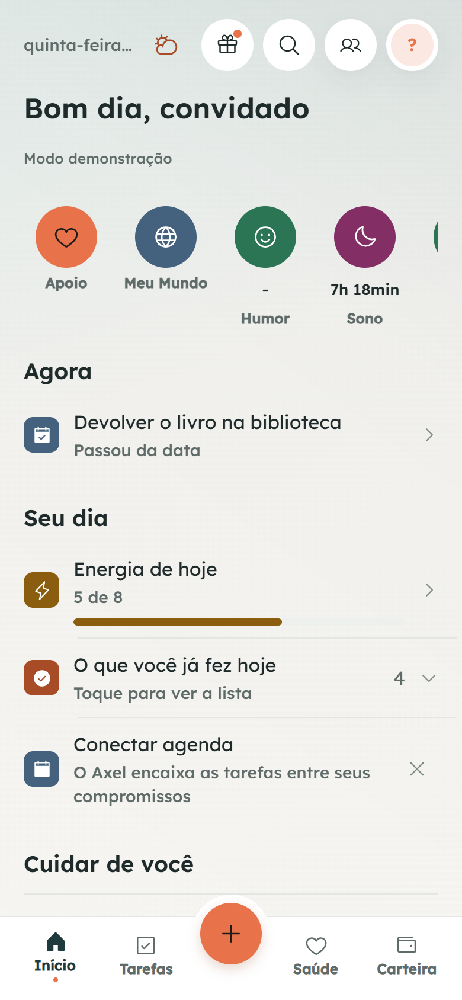
  </picture>
  <picture>
    <source media="(prefers-color-scheme: dark)" srcset="docs/images/app/tarefas-escuro.png" />
    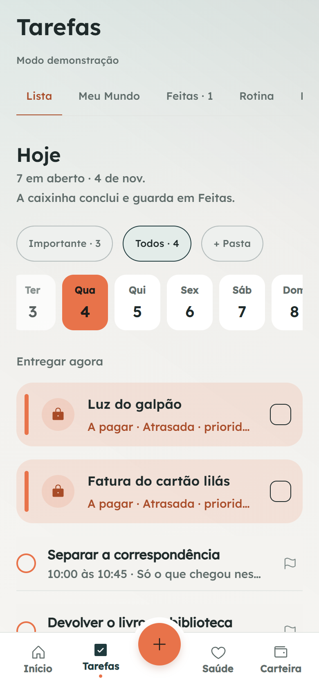
  </picture>
  <picture>
    <source media="(prefers-color-scheme: dark)" srcset="docs/images/app/financas-escuro.png" />
    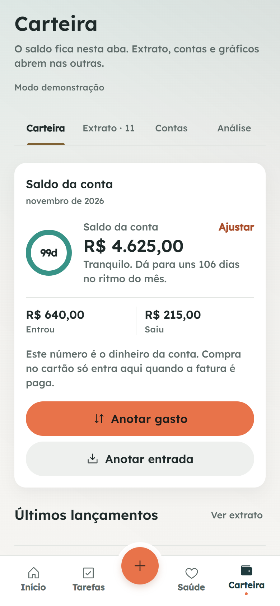
  </picture>
</p>

## Por que o app existe

Eu convivo com ansiedade, depressão e TDAH e tentei me organizar com apps de produtividade comuns. Eles pedem dados demais, mandam notificação o tempo todo, cobram sequência de dias e mostram listas enormes. No dia difícil, isso piora.

O SunFy foi feito para o dia difícil:

* **Um passo de cada vez.** A tela mostra o que importa agora, não a lista inteira.
* **Sem castigo.** Ficar dias sem abrir não apaga nada e não gera cobrança.
* **Tudo no mesmo dia.** Tarefa, humor, remédio, água e conta a pagar ficam juntos.
* **Sugestão com motivo.** O Axel, o assistente do app, sugere a ordem das tarefas e diz por quê. A decisão final é sempre sua.

> O SunFy organiza a rotina. Ele não faz diagnóstico e não substitui terapia ou atendimento médico. Em crise, ligue para o CVV no **188** (gratuito, 24 horas). Em risco imediato à vida, ligue para o SAMU no **192**.

## O que dá para fazer

| Parte do app | Para que serve |
|---|---|
| **Início** | Ver o progresso do dia, registrar sono e humor e saber o próximo passo |
| **Tarefas** | Listar o que fazer, separar por dia e quebrar tarefas grandes em passos pequenos |
| **Saúde** | Diário de humor, água, alimentação, sono, academia, remédios e exercícios de respiração |
| **Carteira** | Saldo, cartões, contas a pagar e quanto sobra no fim do mês |
| **Calendário** | Ver o mês e ligar a agenda do Google, Outlook ou Teams |
| **Mais** | Perfil, preferências, tema, Elo e sair da conta |

<p align="center">
  <picture>
    <source media="(prefers-color-scheme: dark)" srcset="docs/images/app/saude-escuro.png" />
    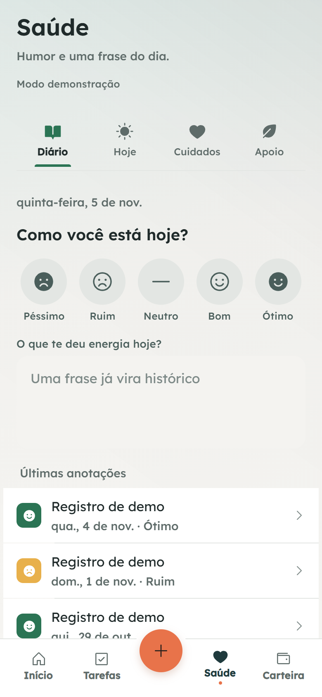
  </picture>
  <picture>
    <source media="(prefers-color-scheme: dark)" srcset="docs/images/app/login-escuro.png" />
    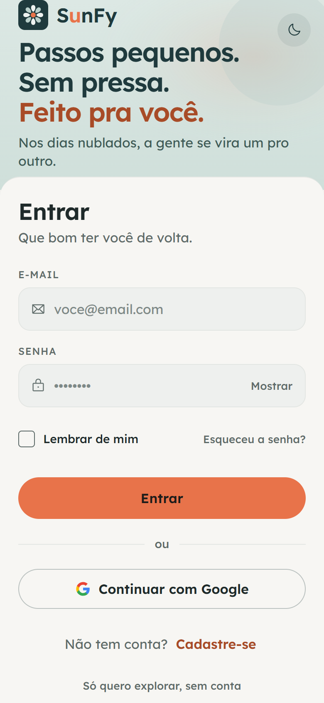
  </picture>
</p>

## Como usar cada seção

Cada seção abaixo mostra a tela e o que fazer nela. Os prints do topo e do passo a passo da manhã continuam no lugar.

### Início

<p align="center">
  
</p>

Abra o app e você cai aqui.

1. Toque na carinha para dizer como está. Se quiser, escreva uma linha.
2. Toque no **+** e despeje o que está na cabeça, uma coisa por linha. Não precisa escolher categoria nem data.
3. Confira o que o app entendeu e salve. Tarefa, gasto e conta a pagar vão cada um para o lugar certo.
4. O AXEL sugere o que fazer agora e diz o motivo. Você decide se segue.

### Modo aventura

<p align="center">
  <picture>
    <source media="(prefers-color-scheme: dark)" srcset="docs/images/app/rpg-escuro.png" />
    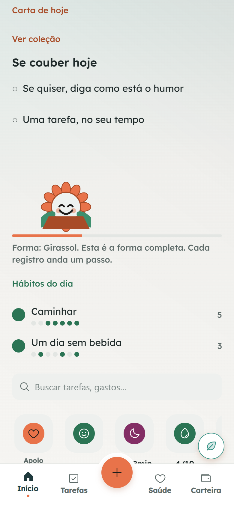
  </picture>
</p>

O modo aventura é opcional. Ele liga em Preferências. O print é do app real, como convidado, com o modo já ligado.

No topo ficam o nível, a forma e as moedas. As moedas não são dinheiro: servem só para a aparência. O AXEL começa broto, vira flor no nível 2 e girassol no nível 5. Embaixo, ele anda um caminho e os hábitos do dia ficam no palco. Humor, água ou tarefa concluída dão um passo. Um dia em branco não apaga o que já foi feito. A carta do dia e as missões aparecem para todo mundo e podem ser fechadas.

### Formas e roupas

<p align="center">
  <picture>
    <source media="(prefers-color-scheme: dark)" srcset="docs/images/app/formas-escuro.png" />
    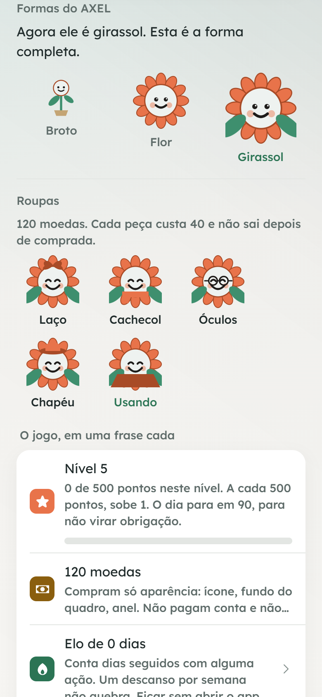
  </picture>
</p>

Em Seu AXEL dá para ver as três formas e as roupas. Cada peça custa 40 moedas. Comprar não tira nível nem as peças que você já tem. Toque de novo para tirar a peça do corpo.

### Hábitos

<p align="center">
  <picture>
    <source media="(prefers-color-scheme: dark)" srcset="docs/images/app/habitos-escuro.png" />
    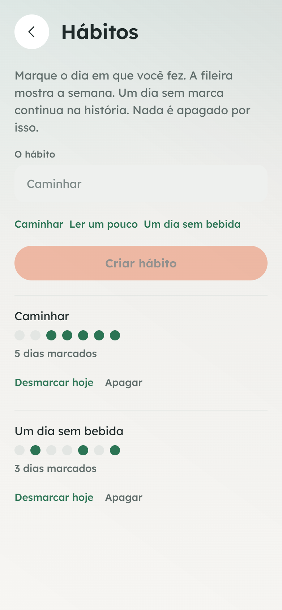
  </picture>
</p>

Um hábito é uma marca no dia. A fileira mostra os últimos sete dias. Faltar um dia não apaga os dias já marcados. No modo aventura, os hábitos também aparecem no palco da Home.

### Meta longa

<p align="center">
  <picture>
    <source media="(prefers-color-scheme: dark)" srcset="docs/images/app/meta-longa-escuro.png" />
    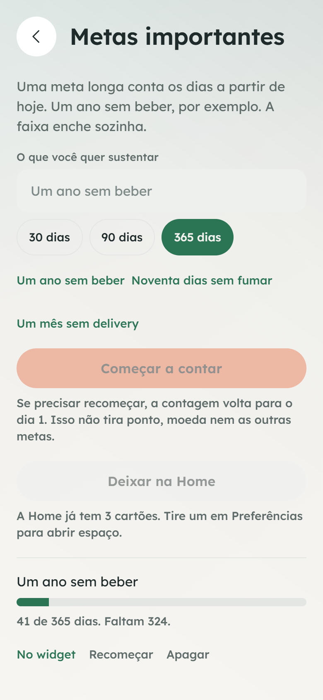
  </picture>
</p>

Uma meta importante conta os dias a partir da data em que você começou. Um ano sem beber, noventa dias ou um mês. A faixa enche sozinha. Dá para deixar o cartão na Home. Recomeçar volta a contagem para o dia 1 e não tira ponto, moeda nem as outras metas. Isso não é a meta de dinheiro da Carteira.

### Tarefas

<p align="center">
  
</p>

1. Veja o que está para hoje e o que ficou para outros dias.
2. Marque o que terminou.
3. Se uma tarefa for grande demais, quebre em passos pequenos.
4. O horário que o AXEL sugere aparece diferente do que veio da sua agenda.

### Saúde

<p align="center">
  
</p>

A Saúde tem três partes. **Hoje** mostra o cuidado do dia. **Cuidados** separa água, comida, academia e remédios. **Diário** guarda humor, sono e o que você anotou.

1. Em Hoje, registre o que cabe agora: um copo de água, o humor, o sono.
2. Em Cuidados, ajuste a meta de água, a alimentação, os dias de academia e os horários do remédio.
3. Em Diário, volte para ver como a semana foi.
4. O app mostra o quanto falta. Ficar dias sem abrir não apaga nada e não cobra sequência.

Se o humor do dia for muito baixo, a aba troca as metas por um check-in curto, dois exercícios de respiração e o CVV (188).

### Carteira

<p align="center">
  
</p>

A Carteira tem quatro abas. Cada uma faz uma coisa.

1. **Carteira.** O número grande é o dinheiro da conta. Toque em Ajustar se o saldo estiver errado. Anotar gasto tira dinheiro. Anotar entrada põe dinheiro. Compra no cartão só entra neste número quando a fatura é paga.
2. **Extrato.** A lista de cada valor que entrou ou saiu. Toque em um lançamento para corrigir.
3. **Contas.** Salário, faturas, contas que se repetem e cartões. Débito e PIX saem do saldo na hora. No crédito, só na fatura paga.
4. **Análise.** Para onde o dinheiro foi no mês e quanto deve sobrar no fim.

O app não se conecta ao banco. Os valores são os que você anota.

### Calendário e Mais

O **Calendário** mostra o mês e o que já está marcado. Dá para ligar a agenda do Google, do Outlook ou do Teams.

O **Mais** fica no canto da tela inicial. Lá estão o perfil, as preferências, o tema, o histórico e o Elo (os dias seguidos). Os pontos de nível ficam no Perfil e não são dinheiro. **Sair da conta** encerra a sessão neste aparelho. **Fechar** só esconde o menu.

<p align="center">
  
</p>

Na primeira vez, os passos iniciais perguntam o nome, o ícone, o que você quer usar e explicam estas seções. Dá para pular e completar depois em Preferências. Quem só quer olhar toca em **Só quero explorar, sem conta** e vê dados de exemplo.

## Como funciona na prática

Uma manhã corrida, em menos de um minuto:

<table>
  <tr>
    <td align="center" width="50%">
      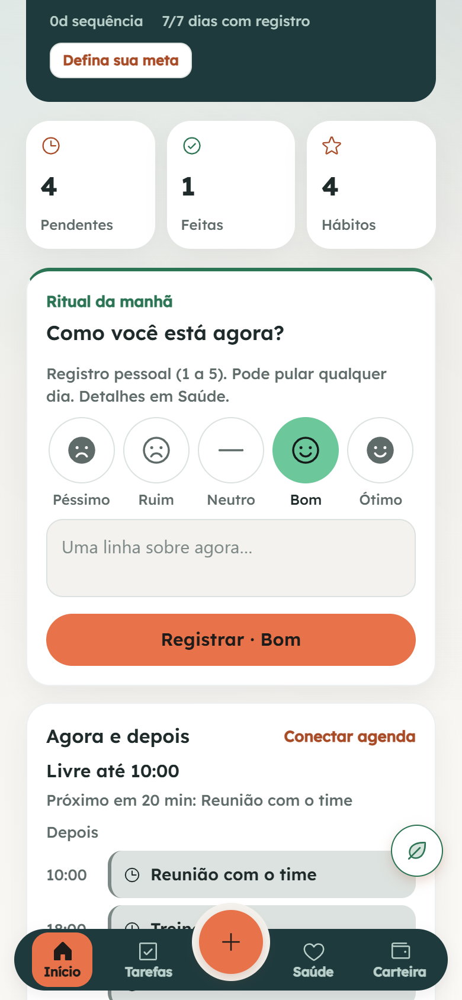<br />
      <strong>1. Diz como está</strong><br />
      Um toque na carinha. Se quiser, uma linha sobre o momento.
    </td>
    <td align="center" width="50%">
      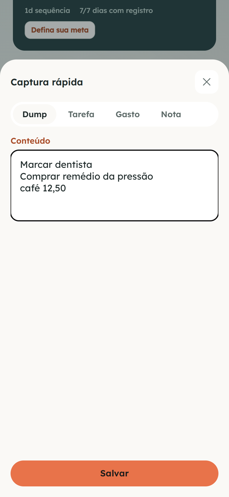<br />
      <strong>2. Tira da cabeça</strong><br />
      Toca no <strong>+</strong> e escreve o que está pendente, uma coisa por linha, sem escolher categoria nem data.
    </td>
  </tr>
  <tr>
    <td align="center" width="50%">
      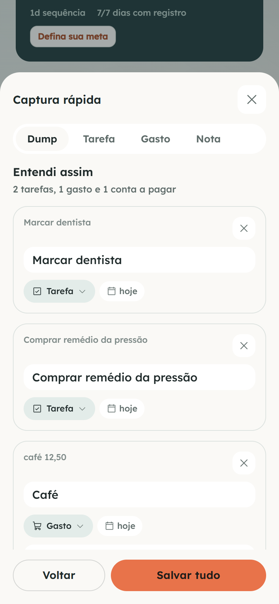<br />
      <strong>3. Confere o que o app entendeu</strong><br />
      O app separa tarefa, lembrete, gasto, entrada de dinheiro e conta a pagar. Dá para corrigir antes de salvar.
    </td>
    <td align="center" width="50%">
      <br />
      <strong>4. O Axel encaixa no dia</strong><br />
      As tarefas entram nos horários livres, entre os compromissos da agenda. Na hora, o app oferece um timer para começar.
    </td>
  </tr>
  <tr>
    <td align="center" width="50%">
      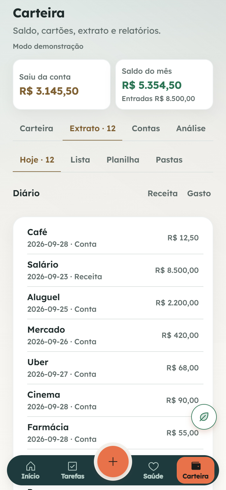<br />
      <strong>5. O dinheiro vai para a carteira</strong><br />
      "café 12,50" virou gasto e "pagar a vitória 8,11" virou conta a pagar. O saldo do mês já está atualizado.
    </td>
    <td align="left" width="50%">
      <strong>Frases que o app entende</strong><br /><br />
      <code>dentista amanhã 9h</code>: tarefa com dia e hora<br />
      <code>ligar pro João às 15h</code>: tarefa (não um gasto de 15)<br />
      <code>me lembra do remédio às 22h</code>: lembrete com aviso<br />
      <code>uber 23</code> ou <code>gastei 50 no mercado</code>: gasto<br />
      <code>recebi 500 do freela</code>: entrada de dinheiro<br />
      <code>colar 44,50 vence dia 11</code>: conta a pagar
    </td>
  </tr>
</table>

Os prints são do app real, no modo convidado.

## Em que o design se apoia

São referências de produto e de interface que o código cita e segue. Não são estudos clínicos, e o app não promete efeito terapêutico.

| Referência | O que veio dela para o SunFy |
|---|---|
| [Tiimo](https://www.tiimoapp.com) (planejador visual para TDAH) | O cartão "Agora e depois": o que é agora, com o tempo restante em barra e em texto, e poucas coisas por vez. A ideia é tornar o tempo visível para quem tem cegueira temporal (dificuldade de perceber o tempo passando), comum no TDAH |
| [Bearable](https://bearable.app) e [Daylio](https://daylio.net) | Ritual da manhã: sono e humor num toque, escala de 1 a 5, nota opcional. Registro rápido em cima, padrões e histórico abaixo |
| [How We Feel](https://howwefeel.org) | Check-in de humor como ação principal da aba Saúde, sem exigir texto |
| [Material Design 3](https://m3.material.io) | Listas agrupadas, abas fixas com indicador, toque com onda no Android, áreas de toque de no mínimo 44 a 48 px |
| [Nielsen Norman Group](https://www.nngroup.com) | Em telas largas, a escala de texto não cresce: tipo maior só espalha o conteúdo e força rolagem |
| [Refactoring UI](https://www.refactoringui.com) | Espaçamento em grade de 4 px e hierarquia por peso e cor, não só por tamanho |
| [WCAG 2.2](https://www.w3.org/TR/WCAG22/) | Contraste mínimo de 4,5:1 para texto (os valores ficam anotados ao lado de cada cor em `packages/ui-tokens/src/colors.ts`), opção de texto maior, alto contraste e menos movimento |
| [CVV](https://www.cvv.org.br) | O contato de apoio emocional fica na aba Saúde, com destaque no modo suave |

Regras que saíram disso:

* **Modo suave.** Quando o humor do dia é 1 ou 2, a aba Saúde troca as metas por um check-in, dois exercícios curtos de respiração e o CVV.
* **Horário sugerido é marcado como sugestão.** O que o Axel encaixa aparece diferente do que veio da agenda.
* **Exercícios de TCC são opcionais e curtos**, com aviso de que não substituem psicoterapia.

## Segurança e privacidade

Humor, remédios e dinheiro são tratados como dado sensível. O que existe hoje no código:

**Acesso aos dados**
* **Cada conta só vê o que é dela, garantido pelo banco.** As migrações em [`supabase/migrations`](supabase/migrations) ativam Row Level Security (RLS) no Postgres do Supabase. Mesmo que alguém chame a API direto, sem a tela, o banco recusa dados de outra conta.
* **A chave do Supabase que aparece no código é a pública** (`sb_publishable_...`). Ela foi feita para ficar no app, e a proteção vem do RLS. A chave de serviço, que ignora o RLS, só existe nas variáveis de ambiente do servidor, nunca no app.

**Login e sessão**
* **Verificação em duas etapas (TOTP)** pode ser ligada no perfil. Para quem ligou, o servidor só aceita sessões que passaram pelas duas etapas: senha sozinha não chama a API.
* **No celular, a sessão fica no armazenamento seguro do sistema** (Keystore no Android, Keychain no iPhone), via `expo-secure-store`.
* **Ao sair da conta, os dados locais daquela conta saem do aparelho**, para quem entrar depois não herdar nada.
* **Apagar a conta** exige ter entrado de novo nos últimos 10 minutos e remove o usuário e os dados ligados a ele.

**Servidor (API na Vercel)**
* As rotas que leem ou gravam dados da conta validam o token de sessão no servidor antes de responder. Webhooks usam segredo próprio.
* **Limite de uso nas rotas de IA** (por exemplo, 120 leituras por dia por conta). Ao passar do limite, o app segue com a leitura local, sem IA.
* **Senhas de app de e-mail (IMAP) ficam criptografadas** com AES-256-GCM. A chave fica só na variável `ENCRYPTION_KEY` do servidor.
* **Botões dentro das notificações** usam um token assinado (HMAC SHA-256) que expira em 24 horas.

**Site**
* Cabeçalhos de segurança em todas as páginas ([`vercel.json`](vercel.json)): Content-Security-Policy restrita, HSTS, `X-Frame-Options: DENY`, `X-Content-Type-Options: nosniff`, Referrer-Policy e Permissions-Policy (microfone e pagamento desligados).

**O que o app não faz**
* Não se conecta a banco nem cartão. Os valores da carteira são os que você anota.
* Não vende nem compartilha dados para anúncios.
* Não pede diagnóstico.

**Encontrou uma falha?** Não abra issue pública. Use a aba **Security** deste repositório, em **Report a vulnerability**, para mandar um relato privado.

## Instalar no celular Android (APK)

O SunFy é um app nativo de Android, instalado por um arquivo APK.

1. Abra no celular o link do build (aparece no fim do comando de build, ou em expo.dev, no projeto, em **Builds**).
2. Toque em **Install** e abra o arquivo baixado.
3. Se o Android pedir, permita instalar apps dessa fonte. Se o Play Protect perguntar, toque em **Mais detalhes** e **Instalar mesmo assim**.
4. Abra o SunFy e entre com a sua conta ou como convidado.

Mudanças de tela chegam pela internet (EAS Update) e não exigem reinstalar. Só é preciso um APK novo quando muda algo nativo, como ícone, permissões ou bibliotecas nativas.

No iPhone, por enquanto, o app funciona pelo navegador.

### Gerar o APK

Todos os comandos rodam dentro de `apps/mobile`. Rodar na raiz do repositório cria um `app.json` e um `eas.json` vazios e o build sai sem configuração.

```bash
cd apps/mobile
npx eas-cli login --no-browser      # usuário e senha da Expo
npx eas-cli whoami                  # tem que mostrar a conta como Owner, sem "limited"
npx eas-cli build -p android --profile preview
```

* Na primeira vez, responda **yes** para gerar o keystore (a assinatura do app). A Expo guarda uma cópia na conta.
* Na pergunta sobre emulador, responda **no**. Ela tenta abrir um emulador no PC e exige o Android Studio.
* O build roda na nuvem da Expo, leva de 10 a 20 minutos e termina com um link e um QR code.

Se aparecer **"Not authorized"** ao gerar o keystore, o login pelo navegador concedeu permissão limitada. Saia (`npx eas-cli logout`) e entre de novo com `npx eas-cli login --no-browser`.

Mandar mudanças de tela sem gerar APK:

```bash
cd apps/mobile
npx eas-cli update --channel preview --message "o que mudou"
```

O guia completo, com notificações e Firebase, está em [`docs/MOBILE_INSTALADOR.md`](docs/MOBILE_INSTALADOR.md).

## Com o que ele foi feito

| Peça | Ferramenta | Por que |
|---|---|---|
| Telas (celular e web) | TypeScript, React Native, Expo | Um código para Android e navegador |
| API e Axel | Node.js na Vercel | Captura, e-mail, notificações e IA sem servidor ligado o tempo todo |
| Banco e login | Supabase (Postgres) | RLS por conta, autenticação e duas etapas prontas |
| Priorização e migrações | Python (FastAPI) e Alembic em `backend/` | Pontuação, análises e histórico de mudanças do banco. Ver [`backend/alembic/README`](backend/alembic/README) |
| Leitura de texto livre | Groq e Gemini | Entender "uber 23" ou "dentista amanhã 9h" sem formulário |

Identidade visual: as quatro cores do ícone (petróleo `#1F3A3D`, menta `#B9CFCA`, creme `#EEF2F0` e coral `#E8734A`) definem os dois temas. A fonte da interface é a Lexend; a Fraunces aparece só no logotipo. Os tokens de cor, tipo e espaço ficam em [`packages/ui-tokens`](packages/ui-tokens).

## Rodar no computador

Para só usar, o link do topo com **Só quero explorar, sem conta** basta. Esta parte é para quem vai mexer no código.

Requisitos: [Node.js](https://nodejs.org) 20 ou mais novo e um projeto gratuito no [Supabase](https://supabase.com). Para o `backend/`, Python 3.11 ou mais novo e `pip install -r backend/requirements.txt`.

```bash
git clone https://github.com/MarianaPlauska/simply-life.git
cd simply-life
npm install
cp apps/mobile/.env.example apps/mobile/.env
```

Preencha `EXPO_PUBLIC_SUPABASE_URL` e `EXPO_PUBLIC_SUPABASE_ANON_KEY` em `apps/mobile/.env` com os dados do seu Supabase. Depois:

```bash
npm run mobile:web   # navegador em http://localhost:8082
npm run mobile       # QR code para testar no celular
```

Arquivos `.env` e chaves privadas não vão para o git. Nunca coloque token de acesso dentro da URL do `git remote`: use o login do Git Credential Manager.

Publicação e servidor: [`docs/DEPLOY_VERCEL.md`](docs/DEPLOY_VERCEL.md) e [`docs/SISTEMA_REFERENCIA.md`](docs/SISTEMA_REFERENCIA.md).

## Atualizar os prints

Com o app rodando no navegador:

```bash
node scripts/readme-shots.mjs   # telas principais
node scripts/readme-flow.mjs    # passo a passo de uso
node scripts/readme-rpg.mjs     # modo aventura, como convidado
```

<p align="center">
  <sub>Feito por <a href="https://github.com/MarianaPlauska">Mariana Plauska</a></sub>
</p>
